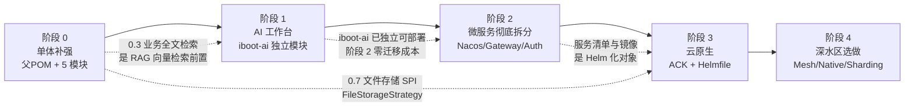

# iBoot 演进路线图(Roadmap)

> **文档定位**:本文是 iBoot 唯一的演进规划文件,取代此前手写的 `TODO.md` 与 `graalvm-native-image-plan.md`(两者内容已吸收进本文第 5、7 章)。
>
> 项目性质:技术栈练习项目。目标是在一个可运行的管理系统之上,逐步长出**微服务**、**云原生**、**智能 Agent** 三块能力,最终以容器为基础运行环境部署到阿里云。
>
> 本文只定义"做什么、用什么、受什么约束、带来什么价值、怎么算完成",不含实施排期。每个条目都带验收判据,判据不成立的条目不进路线图。
>
> 最近更新:2026-10-28

---

## 目录

1. [项目现状盘点](#1-项目现状盘点)
2. [目标与原则](#2-目标与原则)
3. [路线图总览](#3-路线图总览)
4. [阶段详解](#4-阶段详解)
   - [阶段 0 单体补强](#40-阶段-0单体补强)
   - [阶段 1 AI 工作台](#41-阶段-1ai-工作台)
   - [阶段 2 微服务彻底拆分](#42-阶段-2微服务彻底拆分)
   - [阶段 3 云原生](#43-阶段-3云原生ack--helm)
   - [阶段 4 深水区选做](#44-阶段-4深水区选做)
5. [旧 TODO 17 项去向](#5-旧-todo-17-项去向)
6. [跨阶段约束与风险](#6-跨阶段约束与风险)
7. [决策记录](#7-决策记录)

---

## 1. 项目现状盘点

### 1.1 架构形态

单体应用,Maven 多模块(根 `pom.xml` 聚合 `iboot-admin` + 独立 AI 服务 `iboot-ai`),内部遵循 DDD 四层:

```
interfaces  → controller / dto / advisor / config
application → service / mapper(MapStruct)
domain      → 实体与仓储接口(system / job / backup)
infrastructure → config / persistence / repository / security / filter / interceptor / aspect / job / push / storage
```

前端为独立的 `iboot-portal`(Vue 3 + TypeScript + Vite)。

### 1.2 已完成能力

| 能力域 | 具体内容 | 关键实现 |
|---|---|---|
| 认证授权 | 登录、JWT 签发校验、滑动过期、RBAC、五级数据权限 | `AuthController`、`JwtAuthenticationFilter`、`DataScopeInterceptor` |
| 系统管理 | 用户 / 角色 / 菜单 / 字典 / 参数配置 | 25 个 Controller 中的 6 个,`sys_*` 表族 |
| 组织架构 | 部门树、岗位、组织架构图 | `DeptController`、`PostController` |
| 消息中心 | 站内消息、消息模板、公告、已读同步 | `MessageController`、`MessageTemplateController`、`NoticeController` |
| 实时推送 | SSE 单播/组播/广播,集群下 Redis Pub/Sub 广播,CloudEvents 事件格式 | `SseEmitterManager`、`PushEventService`、`common/cloudevent` |
| 文件管理 | 上传/下载/预览/分类,MinIO 与本地双存储 | `FileController`、`MinioService` |
| 数据备份 | 全量逻辑备份、AES-256-GCM 加密、MinIO/本地/OSS 存储、独立演练库恢复校验 | `BackupController`、`BackupApplicationService`、`RestoreDrillService`、`BackupCipher`、doc 21 |
| 定时任务 | Quartz 任务 CRUD、启停、执行日志 | `JobController`(`isClustered: false`) |
| 日志 | 操作日志、登录日志、运行日志(入 ES) | `LogController`、`RunLogApplicationService` |
| 监控运维 | 在线用户、Server 资源(Oshi)、Redis 监控、MinIO 监控、SQL 监控(Druid) | `OnlineUserController`、`ServerMonitorController`、`RedisMonitorController`、`MinioMonitorController` |
| 统计分析 | 仪表板、趋势统计、Excel 导出(FastExcel) | `DashboardController`、`StatisticsController` |
| AI 对话 | 独立 `iboot-ai` 服务:多轮流式对话、Redis 记忆、每日配额、token/延迟观测 | `ChatApplicationService`、`AiChatController`、doc 22 |
| AI 知识库 RAG | 知识库 CRUD、PDF/DOCX/TXT/MD 解析、分块、Embedding、BM25+kNN+应用层 RRF、引用溯源、RBAC+五级数据权限前置过滤、OCR 可选 | `KnowledgeIngestionService`、`KnowledgeRetrievalService`、`RagChatController`、doc 22 |
| 智能体编排 | 受控工具注册（3 只读 + 1 可写）、以用户 JWT 代理 admin、工具级权限继承、写操作两段式确认、运行轨迹审计、确定性回放与真实模型回测 | `AgentRunService`、`AgentScopeRuntime`、`AgentToolRegistry`、`AgentChatController`、doc 22 |
| 国际化 | 前端 vue-i18n + 后端 MessageSource,中英文语言包分层 | `I18nController`、`common/i18n`、doc 17/18 |
| 二级缓存 | Caffeine(L1)+ Redis(L2),Pub/Sub 失效广播,穿透/击穿/雪崩防护 | `TwoLevelCacheManager` |
| 可观测性 | Actuator + Micrometer + Prometheus + Alertmanager + Thanos 长期存储 + Grafana + ELK + 各类 exporter | 见 doc 11 |
| 并发模型 | 虚拟线程已启用(Tomcat + 异步执行器) | 见 doc 16 |
| API 文档 | Springdoc OpenAPI + Swagger UI | `OpenApiConfig` |

数据库版本管理用 Flyway,`iboot-admin` 已推进到 `V26`;`iboot-ai` 使用独立 schema `iboot_ai`,迁移由自身 Flyway 管理(已到 `V2`)。

### 1.3 运行环境

`docker/docker-compose.yml` 提供 **18 个中间件/可观测容器**:

| 分组 | 容器 |
|---|---|
| 数据 | mysql 8.0.45、redis 7.0.14、minio、elasticsearch 9.2.3 |
| 日志 | logstash 9.2.3、kibana 9.2.3、elasticsearch-exporter |
| 指标 | prometheus、alertmanager、grafana、thanos(sidecar / store / query / compact)、mysqld-exporter、redis-exporter、node-exporter |
| 初始化 | minio-init |

**重要事实**:应用本身不在 compose 中(`iboot-admin` 服务块处于注释状态),后端跑在宿主机;前端仅有 `iboot-portal/Dockerfile`,后端镜像尚不存在。

### 1.4 已确认缺口

| 缺口 | 证据 |
|---|---|
| 业务数据行级多语言 | 现有 i18n 只覆盖 UI 文案与异常消息;已决策**暂不做**(原阶段 0.4) |
| 链路追踪 | compose 中无 Zipkin / Tempo / SkyWalking / Jaeger,doc 11 提到但环境未落地 |
| 服务注册 / 配置中心 / MQ / 分布式事务 | 完全未引入 |
| K8s 编排 | 无 Deployment/Helm 清单,只有 docker-compose |
| 后端容器镜像 | 无 `iboot-admin/Dockerfile` |
| GraalVM Native | 计划文档存在,零实施 |
| SSO / 零信任 / 多租户 | 未起步 |

### 1.5 文档与实现的偏差

以下偏差已逐项处理完毕:

| 位置 | 原问题 | 处理结果 |
|---|---|---|
| `doc/02-技术栈.md` | 写 Spring Boot **3.5.9**,实际 pom 为 **4.0.3** | ✅ 已修正为 **4.0.3**(Spring Framework / Security 同步为 7.x) |
| `doc/02-技术栈.md` | 依赖清单列 `elasticsearch-java 8.17.0` | ✅ 已修正为 **9.2.5**(由 Boot 4.0.3 托管,与 ES 9.2.3 同属 9.2.x) |
| `README.md` | 徽章写 "Spring Boot 4.x",与 doc 02 冲突 | ✅ 无需修改;doc 02 修正后二者一致,以 pom 为准 |
| `TODO.md` / `graalvm-native-image-plan.md` | 非规范文档,内容陈旧 | ✅ 已删除,由本文取代 |

---

## 2. 目标与原则

### 2.1 三块目标能力与完成判据

| 能力 | 本项目的定义 | 完成判据 |
|---|---|---|
| **微服务** | 现有单体按 DDD 限界上下文**彻底拆分**为多个独立可部署服务,Spring Cloud Alibaba 技术栈真实承载(非摆设) | 任一服务可独立启停与发布;单服务故障不雪崩;跨服务强一致写具备可回滚的分布式事务 |
| **云原生** | 所有服务容器化,Helm 化,运行在阿里云 ACK,具备弹性、可观测、声明式发布 | `helmfile sync` 一条命令完成发布;滚动升级零 5xx;压测触发 HPA;删 Pod 自愈 |
| **智能 Agent** | 以百炼 Qwen 为对话底座的多能力 AI 工作台:对话、RAG、智能体编排、知识图谱 | Agent 能安全地调用既有管理端 API 完成任务;RAG 检索结果继承用户数据权限 |

### 2.2 约束与原则

1. **验收判据优先**:无判据的条目不写。写代码前先定义"什么算完成"。
2. **YAGNI**:与主线弱相关、或职责与已选方案重叠的条目,显式剔除而非长期挂账(见 § 5)。
3. **复用既有基础设施优先**:已有 ES、MinIO、Redis、Quartz、SSE、CloudEvents、二级缓存、可观测栈——先榨干存量,再引入新中间件。
4. **不破坏 DDD 边界**:阶段 0 新增模块必须待在既有四层结构内,否则阶段 2 拆分成本被推高。
5. **前端契约稳定**:拆分与网关化过程中,portal 继续只访问网关 `/api/**`,接口归属变化只改路由表。
6. **不为练手而降级主线**:工程已站在 Boot 4.0.3 上,不为了迁就某个旧版生态而退回已 EOL 的 Boot 3.5。
7. **成本可见**:任何消耗云账单或本机内存的能力,必须自带用量观测。

---

## 3. 路线图总览



| 阶段 | 主题 | 为什么在这个位置 |
|---|---|---|
| **0** | 单体补强 | 在仍是最省事的时候补功能洞;DDD 边界因此更完整,后续拆出的服务才有业务含义。同时用父 POM 把"未来拆分"从重写工程结构降级为加一个 module |
| **1** | AI 工作台 | AI 是**新增一个服务**而非改造现有服务,不需要拆分底座先存在;做成独立模块后,阶段 2 只是给它注册进 Nacos |
| **2** | 微服务彻底拆分 | 有了完整的单体 + 一个已验证的独立服务作参照,拆分方法论才成立;认证中心是其余所有服务的依赖前置 |
| **3** | 云原生 | 上云对象是"多个服务",先拆后上才对应 Helm 的价值;提前上云会把单体 + 18 个中间件全塞进 K8s,收益被运维吃掉 |
| **4** | 深水区选做 | 服务网格、native、分库分表都会改变运行模型,必须在服务稳定之后 |

**顺序的唯一硬约束**:阶段 1 的 AI 必须是独立模块 / 独立可部署单元,不能是 `com.iboot.admin.ai` 这样的包——否则阶段 2 要把已写好的 AI 能力从单体里挖出来重做。

---

## 4. 阶段详解

### 4.0 阶段 0:单体补强

目标:补齐功能洞、修正文档与依赖偏差、并把工程结构预备成多模块。全部工作待在既有 DDD 边界内。

| 编号 | 子项 | 技术栈 | 约束 | 验收判据 |
|---|---|---|---|---|
| **0.1** | 父 POM 多模块预备(**已完成**) | Maven 聚合 `iboot-parent`,`modules = iboot-admin` + 预留 `iboot-ai`;依赖版本集中到 `dependencyManagement` | 纯构建结构改造,**不动一行业务代码** | `mvn verify` 绿;Docker 中间件环境与前端联调行为零变化 |
| **0.2** | 数据备份与恢复(**已完成**) | Quartz(已有)+ `mysqldump`(经 `docker exec` 复用容器内 8.0.45 客户端)+ AES-256-GCM + `FileStorageStrategy`(MinIO/本地/OSS)+ `db_backup_record` / `db_restore_record` + 恢复演练 + 管理端“数据备份”页;能力契约见 `openspec/specs/data-backup/spec.md`,操作指南见 `doc/21` | 恢复目标必须是独立演练库 `iboot_restore_drill`,**禁止覆盖原库**;`mysqldump` 版本须与 MySQL 8.0.45 匹配;大库逻辑备份耗时,binlog 增量留作选做;功能默认关闭,密钥经 `IBOOT_BACKUP_ENCRYPTION_KEY` 注入 | 定时备份产物落 MinIO;一次完整恢复演练成功且行数 / 校验和一致;手动与定时触发均可用;业务库行数与结构不受演练影响 |
| **0.3** | 业务全文检索(**已完成**) | 复用已部署的 ES 9(原先仅存运行日志,现新增 `iboot-content-v1`),公告 / 站内消息建索引(中文 `cjk` 分析器);写入走 Spring 事件异步(`@TransactionalEventListener` 已有先例)+ Quartz 每 5 分钟无状态对账 | ES 客户端已随 Boot 4.0.3 升至 **9.2.5**,与 ES **9.2.3** 同属 9.2.x,兼容前置已满足;不引入 Canal(重);**文件内容检索并入阶段 1**(与 RAG 解析管线、文件数据权限一起做);能力契约见 `openspec/specs/content-search/spec.md` | 公告/消息可检索且消息按接收人隔离;源数据删改后 5 分钟内索引一致 |
| **0.4** | 行级业务多语言(**暂不做**) | 翻译表 `sys_i18n_value(lang, table, row_id, field, value)` + MyBatis 拦截器自动替换与默认语言回退 + 复用二级缓存 | 与 `DataScopeInterceptor` 的拦截器链顺序敏感;与 PageHelper 的分页改写需兼容;回退规则须先定死(默认语言缺失 → 空还是回退) | 同一记录中/英切换返回正确字段;数据权限过滤仍生效 |
| **0.5** | 审批流 / 工作流(**已完成**) | Flowable **8.0.0** on Boot 4.0.3:domain `WorkflowService` + infrastructure 适配器,请假流程与审批中心;能力契约见 `openspec/specs/approval-workflow/spec.md`,选型依据见 `doc/spike/flowable-8-spike-report.md` | 7.x 不支持 Boot 4,8.0.0 为唯一版本线;原 fallback Spring Statemachine 已归档,不再作为既定降级方案;`taskExecutor` 已适配为 `AsyncTaskExecutor`,HikariCP 已排除,`ACT_*` 表由 Flyway `V17` 管理 | 一条真实流程已跑通:发起 → 审批 → 驳回 → 归档 |
| **0.6** | 多渠道通知(**已完成,短信默认关闭**) | 渠道 SPI(站内 SSE 已落库 / Spring Mail / 阿里云短信 Dysmsapi / 钉钉 webhook)+ 复用 `sys_message_template` + `sys_notification_delivery` 投递表 + Quartz 失败重试 + 管理端投递页 | 短信因个人实名资质限制仅实现不启用,启用需企业或个体工商户资质;密钥不入仓(env / Nacos);阶段 2 后重投职责移交 RocketMQ | 审批待办事件在站内/邮件/钉钉三个真实渠道可达;短信契约测试通过且默认关闭;失败可见且可重试 |
| **0.7** | 衔接性抽象(**已完成**) | 把文件存储收敛为 `FileStorageStrategy` SPI(Local / MinIO / OSS / 内存实现),提供方由 `sys.file.storageType` 选择 | 阶段 3 的 MinIO→OSS 替换依赖它;两者 SDK 不兼容,不做抽象则上云要改遍文件相关代码 | 本地跑 MinIO 实现、测试跑内存实现,行为一致 |
| **0.8** | 文档修正(**已完成**) | `doc/02-技术栈.md` 版本号 3.5.9 → 4.0.3;ES 客户端版本描述 | — | 文档与 pom 一致 |

### 4.1 阶段 1:AI 工作台

目标:以 `iboot-ai` 独立可部署模块交付 AI 工作台。能力清单不一次性完成,按依赖关系拆为四个增量(1.1–1.4),每个增量都是可独立演示、可独立验收的终态。

#### 底座选型(已核查)

Boot 4.0.3 这一前提改变了可选生态:

| 组件 | 现状 | 结论 |
|---|---|---|
| Spring AI | 2.0.x 才支持 Boot 4(1.1.x 仅到 Boot 3.5);2.0.1 GA 于 2026-08-21 | **采用 Spring AI 2.0.1** |
| Spring AI Alibaba | 稳定线 1.1.2.2 要求 Boot 3.x;2.x 仅有 `v2.0.0-M1.1` 预发布且 pin 在 Spring AI 2.0.0-M1(非 GA) | **暂不引入**,其 2.x GA 后作为可选增强(DashScope VectorStore / Graph / Studio) |
| AgentScope Java | 独立仓库,2.0.1 已 GA(2026-08-05),JDK 17+,Agent Card 可注册 Nacos,支持 MCP / A2A / SSE / HITL | **采用 2.0.1 做智能体编排** |
| 百炼 Qwen | `qwen3.8-flash`(1M 上下文,OpenAI 兼容端点);备用 `qwen3.7-flash` | **对话底座** |
| DeepSeek | Spring AI 官方 `spring-ai-deepseek` + OpenAI 兼容端点 | 备用端点,不默认启用 |

**架构决定**:对话与 Embedding 统一走百炼(DashScope),模型标识与 base-url 配置化;DeepSeek 仅作为故障切换的备用端点。测试用假模型实现。

**单一供应商的约束**:对话与 Embedding 都走百炼,故障半径重叠。因此 base-url 与模型必须配置化,并保留 DeepSeek 作为对话备用端点;Embedding 暂无等价兜底。多供应商抽象已由 Spring AI 的 `ChatModel` / `EmbeddingModel` 提供,不再需要自研。

#### 子阶段拆分

能力按依赖关系拆为四个增量;"硬前置"不成立则不得开工。

| 编号 | 子阶段 | 能力 | 硬前置 | 可独立演示的终态 | 交付状态 |
|---|---|---|---|---|---|
| **1.1** | AI 底座与智能对话 | 模块骨架、多供应商抽象、智能对话、LLM 可观测 | 0.1 父 POM(已完成) | portal 多轮流式对话可用;Grafana 有 token 用量看板且超阈值告警 | **已完成(2026-10-25)** |
| **1.2** | 知识库 RAG 与权限一致性 | 知识库 RAG、RAG 权限一致性、文档解析(文本类) | 1.1;0.3 全文检索(已完成) | 知识库可上传 → 入库 → 带溯源问答;低权限用户红队用例不越权 | **已完成(2026-10-25)** |
| **1.3** | 智能体编排 | 智能体编排 | 1.1;JDK 25 Spike(§6.2 R8)通过 | 3 个只读工具端到端可用;写操作二次确认不可绕过 | **已完成(2026-10-28)** |
| **1.4** | 知识图谱 | 知识图谱 | 1.1;Neo4j 中间件 | 组织架构 + RBAC 入图;2 跳关系查询正确 | 选做 |
| — | ~~数字人~~ | 数字人 | — | 仅保留 Provider 接口,不实现 demo | **剔除** |

排序依据:

- **1.1 必须最先**:其余能力共用 `ChatClient`、Embedding 与模型 base-url 配置;第二供应商的抽象也在这一层落地。
- **LLM 可观测随 1.1 同批交付**:token 消耗从第一行对话代码就产生;埋点后补要改遍所有调用点,且 §6.3 已把配额与告警列为成本红线。
- **1.2 中权限一致性不可延后**:无权限过滤的 RAG 是安全缺陷而非功能缺口(§6.2 R5),因此红队用例是 1.2 的验收项,不能留到后续增量补。
- **文档解析不独立成阶段**:它是 1.2 解析管线的可插拔实现。文本类 PDF/Word 随 1.2 交付;扫描件 OCR 依赖云密钥与出云合规,作为可插拔解析器后接,默认关闭。
- **1.3 与 1.2 无依赖,可并行**;R8 已由 Spike 消除。Agent Card 的 Nacos 注册顺延到阶段 2.1(1.3 时 Nacos 尚不存在),1.3 只保留 Agent 定义与工具白名单。
- **1.4 最后**:Neo4j 是新增中间件,直接撞 §6.2 R4 的本机内存约束;且 GraphRAG 建模需要真实语料才有验证价值。

#### 1.1 AI 底座与智能对话

| 能力 | 技术栈 | 约束 | 验收判据 |
|---|---|---|---|
| 模块骨架与模型接入 | `iboot-ai` 独立 Maven 模块 + 独立 JVM(8081);Spring AI 2.0.1;模型 base-url 配置化,百炼(DashScope)为主、DeepSeek 为备用端点,测试用假模型实现 | 必须独立模块,不能是 `com.iboot.admin.ai` 这样的包(§3 唯一硬约束);embedding 供应商抽象同批落地;容器化留到阶段 3.1 | 模块可独立启动并经 portal 访问;切换 base-url/模型不改代码 |
| 智能对话 | Spring AI `ChatClient` + 会话记忆(Redis)+ **复用现有 SSE 基建**做流式 token | SSE 超时/心跳沿用现配置;流式通道与业务推送通道分离;LLM 调用是阻塞 I/O,与已启用的虚拟线程契合 | 多轮上下文正确;首 token < 3s;模型不可用时降级可见 |
| LLM 可观测 | token 用量 / 延迟 / 失败率 → Micrometer → 既有 Prometheus + Grafana + Alertmanager | 不设配额与告警则云账单失控 | 用量看板有数据;超阈值触发告警 |

#### 1.2 知识库 RAG 与权限一致性

| 能力 | 技术栈 | 约束 | 验收判据 |
|---|---|---|---|
| 知识库 RAG | 上传复用 MinIO/File → 解析 → 分块 → Embedding → **ES 9 `dense_vector` + KNN + BM25 混合检索(RRF)** → 引用溯源 | ES 客户端已随 Boot 4.0.3 升至 9.2.5;前置依赖 0.3 的索引与检索能力,文件内容检索沿用 `openspec/specs/content-search/spec.md` 的可见性契约;分块策略需调优;embedding 产生持续 token 成本;**ES 基础许可证不含原生 RRF,融合在应用层按 `1/(60+rank)` 完成** | 50 篇自建测试集 Top-5 召回 ≥ 80%;答案带可点击溯源 |
| **RAG 权限一致性** | 检索前置过滤 RBAC + 数据权限(复用 `DataScopeInterceptor` 语义) | **不做鉴权的 RAG 等于把全量数据泄漏给最低权限用户**,这是安全缺陷而非功能缺陷;与检索同批交付,不得后补 | 红队用例:低权限用户提问**不得**召回越权内容 |
| 文档解析 | 文本类 PDF/Word 解析器随 1.2 交付;扫描件 OCR(百炼 `qwen3.5-ocr`)作为可插拔解析器 | 需云密钥;扫描件出云的隐私问题;按次计费 → 默认关闭;只对无文本页送云 | 文本类文档解析入库并被检索命中;启用 OCR 后扫描 PDF 同样可命中 |

#### 1.3 智能体编排

**交付状态:已完成(2026-10-28)**。能力契约见 `openspec/specs/ai-agent/spec.md`,操作指南见 doc 22 §12,Spike 结论见 `doc/spike/ai-1.3-spike-report.md`。

| 能力 | 技术栈 | 约束 | 验收判据 |
|---|---|---|---|
| 智能体编排 | AgentScope Java 2.0.1;工具 = 既有管理端 API(查用户 / 查登录日志 / 查备份状态 / 触发备份) | JDK 25 Spike 已通过;只允许 `AgentTool` 注册(禁用 `@Tool` 与结构化输出,规避 victools 双版本冲突);写操作两段式确认;统计接口先补 `report:view` / `usage:view` | 3 个只读工具端到端正确;写操作二次确认不可绕过 |

#### 1.4 知识图谱(选做)

| 能力 | 技术栈 | 约束 | 验收判据 |
|---|---|---|---|
| 知识图谱 | Neo4j + GraphRAG;**最小可用图 = 把 `sys_dept` / `sys_user` / `sys_role` / `sys_menu` 入图**(数据现成,回答"谁能访问什么""跨部门协作路径"这类多跳问题) | 新增中间件 +1;受 §6.2 R4 内存约束;GraphRAG 建模需真实语料支撑 | 组织架构 + RBAC 入图;2 跳关系查询正确 |

#### 已剔除

| 能力 | 原方案 | 剔除理由 |
|---|---|---|
| 数字人 | Provider 接口 + 阿里云虚拟数字人单场景 demo(公告播报) | 需 TTS + 前端渲染 + 第三方 SDK,与 Java 主线弱相关;价值最低、成本最高。仅保留 Provider 接口占位,不实现 demo,不计入验收 |

**交付物**:`iboot-ai` 独立 Maven 模块 + 独立 JVM(8081,容器化留到阶段 3.1),前端 portal 新增 AI 工作台视图,流式采用 POST + `fetch`/`ReadableStream`(新增 `utils/aiStream.ts`,业务推送的 `eventsource.ts` 不变)。视图随增量交付:对话与用量看板随 1.1,知识库管理随 1.2,Agent 配置随 1.3;1.4 不新增独立视图。

> 因为 AI 服务从 1.1 起就是独立可部署单元,阶段 2 只需把它注册进 Nacos 并加网关路由,**零迁移成本**。这是它能排在彻底拆分之前的唯一理由。

### 4.2 阶段 2:微服务彻底拆分

#### 2.0 前置门禁(Spike 不过则不开拆)

| 门禁 | 内容 | 判据 |
|---|---|---|
| 2.0-A | Spring Cloud Alibaba `2025.1.0.0`(支持 Boot 4.0.x + Spring Cloud 2025.1.x)三件套冒烟 | 两服务互相发现;配置热更新生效;Sentinel 限流规则生效 |
| 2.0-B | 链路追踪选型验证(OpenTelemetry 而非 SkyWalking agent) | 两个服务间调用能看到一条完整 TraceID |

#### 2.1 底座交付

- **Nacos**:注册中心 + 配置中心。⚠️ 必须用 `spring.config.import`,不沿用 `bootstrap.yml`(见 R9)。
- **Spring Cloud Gateway**:路由表吸收接口归属变化,承载鉴权前置、统一 CORS、限流入口。
- **OpenTelemetry 链路追踪**:`docker-compose.yml` 中当前**没有任何 tracing backend**,而拆分后的可排障性完全依赖贯穿的 TraceID——因此追踪后端(Tempo 或 ARMS)与网关、Nacos 同批交付,不可后置。
- **契约测试**:拆分后各服务接口独立演进,用契约测试守住 `/api/**` 不漂移(替代原 TODO#10 的 Rest Docs)。

#### 生态版本事实(核查结论)

| 组件 | 在 Boot 4.0.3 上的现状 |
|---|---|
| Spring Cloud Alibaba | ✅ `2025.1.0.0` 正式支持 Boot 4.0.x(Nacos 3.1.1 / Sentinel 1.8.9 / Seata 2.x) |
| Nacos | ⚠️ **bootstrap 方式已移除**,必须改用 `spring.config.import` |
| Apache Dubbo | ❌ `dubbo-spring-boot-starter` **尚不支持 Boot 4** → 本轮**延后**,不剔除 |
| SCA for Boot 4.1 | 🚧 仍在升级 → **锁 Boot 4.0.x,不追 4.1** |

**Dubbo 的处理**:服务间先走声明式 HTTP + Nacos 服务发现(虚拟线程下 `WebClient` 足够,当前瓶颈不是 RPC 吞吐)。等 Dubbo 发布 Boot 4 兼容版本后,再作为增量替换内网热点调用。这是"延后"而非"否决"。

#### 2.2 认证中心与 SSO(原 TODO#4)

`iboot-auth` 用 **Spring Authorization Server**(OAuth2 / OIDC)承接现有 `AuthController` + JWT 签发 + Redis 会话;其余服务全部退化为**纯资源服务器**(只校验 token,不再持有登录逻辑)。

约束:前端登录流程要从"密码直接换 JWT"改为授权码流程——44 个视图里只动登录页与路由守卫,不动业务页。这是阶段 2 中唯一必然触及前端的改动,范围须守住。

#### 2.3 拆分蓝图

| 服务 | 来源 | 拆分理由 |
|---|---|---|
| `iboot-gateway` | 新建 | Spring Cloud Gateway:路由、鉴权前置、统一 CORS、限流入口 |
| `iboot-auth` | 从 admin 抽出 `AuthController` + JWT + Redis 会话 | 认证中心 / SSO,其余服务的依赖前置 |
| `iboot-file` | 文件管理 + 0.7 `FileStorageStrategy` | 边界清晰、依赖少 |
| `iboot-notify` | 消息中心 + SSE 推送 + 0.6 多渠道通知 | **有状态连接**,独立最能体现价值 |
| `iboot-job` | 定时任务 + 0.2 数据备份(Quartz 驱动) | 调度语义独立 |
| `iboot-monitor` | 监控运维 + 日志 + ES | 读多写少,可独立扩缩 |
| `iboot-workflow` | 0.5 审批流 | 流程引擎是重资产,独立部署边界最清晰 |
| `iboot-system` | 用户/角色/菜单/部门/岗位/字典/配置 | **最后拆**,被所有服务依赖 |
| `iboot-ai` | 阶段 1 产出 | 只做注册 + 路由,零改造 |

**拆分顺序**:依赖少的先拆 → `file` → `notify` → `job` → `monitor` → `workflow` → `system`。

**前端零改动的关键机制**:portal 继续只访问网关 `/api/**`,接口归属变化只改网关路由表。

#### 2.4 一致性分工(不是全替换)

| 场景 | 方案 | 理由 |
|---|---|---|
| 跨服务强一致写(如删部门级联用户与角色) | **Seata AT** | 真实需要回滚的边界才上分布式事务 |
| 二级缓存失效、SSE 跨实例广播 | **保留 Redis Pub/Sub** | 低延迟、fire-and-forget 语义匹配,换 MQ 是负优化 |
| 业务事件、通知削峰、跨服务最终一致 | **RocketMQ**,事件格式直接复用既有 `common/cloudevent` 包 | 存量格式已是 CloudEvents 兼容 |
| 限流熔断降级 | **Sentinel**,规则持久化到 Nacos | — |
| 数据 | 每服务独立 schema(同实例逻辑分库),Flyway 按服务分目录 | 为阶段 4 ShardingSphere 铺路 |
| 调度 | Quartz `isClustered` 由 false → true,或 ElasticJob | 拆分后不集群化会重复执行 |

#### 2.5 诚实的成本

- **内存**:8 个 JVM,叠加现有 18 个中间件容器,本机内存是真实瓶颈(每服务 512MB–1GB 堆)。缓解:本地只跑正在改的服务(按需 docker profiles)+ 依赖服务 mock。这也让阶段 4 的 native 化有了**非练手**的理由。
- **复杂度**:部分失败、幂等、调试面扩大——这正是链路追踪必须先行的原因。

#### 2.6 验收判据

1. 端到端链路 TraceID 贯穿(网关 → auth → system → file → notify)。
2. 停掉任一服务:网关返回明确降级错误,不雪崩,Sentinel 规则可观测。
3. Seata 回滚演练:跨服务事务中途失败,数据最终一致。
4. Nacos 配置热更新不需重启生效;bootstrap 相关配置已完成迁移。
5. **前端零改动**跑通:登录 → 改用户 → 上传文件 → 收到 SSE 消息。

### 4.3 阶段 3:云原生(ACK + Helm)

| 编号 | 内容 | 技术栈 | 约束 | 验收判据 |
|---|---|---|---|---|
| 3.1 | 镜像工程 | 每服务多阶段 Dockerfile + distroless + 非 root 运行 + 推 **ACR** | 当前后端镜像不存在,portal 是唯一已有 Dockerfile;基础镜像需与 GraalVM/native 路线兼容 | 每服务镜像 < 200MB 且可启动 |
| 3.2 | Helm 组织 | **Helmfile + 一个通用 library chart** | 避免 8 份重复 chart 样板 | `helmfile sync` 幂等 |
| 3.3 | K8s 清单 | Deployment / Service / ConfigMap / Secret / HPA / PDB / NetworkPolicy / Ingress(ALB) / 命名空间(dev, prod) | Secret 走 KMS 或 ACK Secret 管理,不入仓 | 滚动升级零 5xx;删 Pod 自愈 |
| 3.4 | 中间件分层混合 | 本地 Kind 全自建(MySQL/Redis/ES/Nacos/RocketMQ)练手;云上数据层用 RDS MySQL / Tair / 阿里云 ES / **OSS(替 MinIO)** / MSE Nacos / 云 RocketMQ | 云上跑有状态中间件的学习收益 < 运维成本;MinIO→OSS 依赖 0.7 的 `FileStorageStrategy` 抽象 | 本地与云上同一份镜像、不同 values 可跑 |
| 3.5 | 可观测上云 | 指标:ARMS 托管 Prometheus 或 kube-prometheus-stack;日志:Logtail→SLS(本地 ELK 保留);追踪:Tempo / ARMS | SLS 按量计费需设采集白名单;Thanos 在云上可被托管方案替代 | 云上 Grafana 看到同一套业务面板 |
| 3.6 | CI/CD | GitHub Actions 或云效 Flow:构建 → 镜像推 ACR → `helmfile sync` → dev 晋升 prod → `helm rollback` | 密钥走 CI Secrets,不入仓 | 一次提交自动完成 dev 发布与回滚演练 |
| 3.7 | 弹性与成本 | request/limit 调优、HPA 按 CPU + 自定义 QPS 指标、突发负载用 ECI/ASK | 常驻资源是主要账单 | 压测触发 HPA 扩容且账单可观测 |

### 4.4 阶段 4:深水区选做

| 条目 | 内容 | 约束 / 前置 |
|---|---|---|
| **服务网格零信任**(原 TODO#2) | ACK ASM 或 Istio,mTLS 全链路 + 服务间授权策略 | 改变运维模型,必须在服务稳定后;sidecar 开销与虚拟线程 / native 路线需一并评估 |
| **GraalVM Native** | **目标重定义**:先对 `iboot-gateway`(WebFlux、无 MyBatis、反射面最小)做可行性验证,**不照旧文档对 iboot-admin 全量做**;真实动机是缓解阶段 2 的 N×JVM 内存与阶段 3 的冷启动 | Boot 4 native 要求 GraalVM **25** 工具链;Druid / MyBatis / ES / MinIO / Quartz 的反射与代理风险清单依然成立 |
| **分库分表** | ShardingSphere-JDBC | 拆分后每服务独立 schema 是其前置;× Boot 4 兼容需验证 |
| **Dubbo RPC** | 内网热点调用替换 | 等待 Boot 4 兼容版本(见 § 6.2) |
| **Spring Batch** | 批处理(报表、备份、对账) | 与 Quartz 职责划清 |
| **多租户 SaaS 化** | `tenant_id` + MyBatis 插件 + Nacos 命名空间隔离 | 刻意从阶段 0 推迟:它是横切改造,现在做会让每张表都背租户改动、污染拆分边界;拆分后作为跨服务能力施加更合理 |
| **Spring LDAP** | 企业目录接入 | 需真实 LDAP 环境 |
| **日志/行为流 → Flink** | Kafka + Flink 一条线 | 仅在有真实流分析场景时启动 |

---

## 5. 旧 TODO 17 项去向

迁移完整性对照,逐条可追。

| # | 原条目 | 去向 | 说明 |
|---|---|---|---|
| 1 | 数据备份与恢复 | **阶段 0.2(已完成)** | Quartz + `mysqldump` + AES-256-GCM + MinIO/OSS + 独立演练库恢复校验 |
| 2 | 零信任网络 | **阶段 4** | mesh mTLS |
| 3 | 微服务拆分 + SCA(Nacos/Seata/Sentinel/RocketMQ) | **阶段 2** | 彻底拆分 |
| 4 | SSO 统一认证中心 | **阶段 2.2** | Spring Authorization Server |
| 5 | Apache Dubbo RPC | **阶段 2 延后 → 阶段 4 重评** | 无 Boot 4 支持;服务间先 HTTP |
| 6 | Spring Batch | **阶段 4** | 批处理 |
| 7 | Spring Cloud Data Flow | **剔除** | 与 RocketMQ + Batch 职责重叠,运维面过重 |
| 8 | Spring Statemachine | **与阶段 0.5 二选一** | 由审批流方案吸收 |
| 9 | Spring Integration | **剔除** | 事件驱动 + MQ 已覆盖 |
| 10 | Spring Rest Docs | **改判**:保留 Springdoc,阶段 2 补**契约测试** | Rest Docs 与 OpenAPI 文档生成重复;拆分后真正需要防的是接口漂移,那是契约测试的职责 |
| 11 | Spring LDAP | **阶段 4 选做** | 需真实目录服务 |
| 12 | Kafka | **收敛**:RocketMQ 为主 MQ;Kafka 仅在流处理线引入 | 双 MQ 无收益 |
| 13 | 大数据技术集成 | **剔除** | 数仓与管理系统主线弱相关;真要分析走 ES/Flink |
| 14 | 流处理 / 批处理 | **阶段 4**(Flink 选做 / Batch) | — |
| 15 | AI 工作台(知识图谱、知识库、小模型、数字人、langchain4j/AgentScope/SAA、智能对话与编排) | **阶段 1 拆为 1.1–1.4 覆盖**;知识图谱(1.4)为选做,数字人剔除只留接口;"小模型(文字识别)"由云 API 承接(OCR) | langchain4j 与 SAA 因 Boot 4 约束改为 Spring AI + AgentScope Java,详见 § 7.2 |
| 16 | ShardingSphere + ElasticJob | ElasticJob → **阶段 2**(调度集群化);ShardingSphere → **阶段 4** | — |
| 17 | 业务数据全面国际化 | **阶段 0.4(暂不做)** | 续接已完成的 i18n |

**原 GraalVM 文档的去向**:关键结论与勘误沉淀在 § 7.1。

---

## 6. 跨阶段约束与风险

### 6.1 版本矩阵(锁定的事实基线)

| 组件 | 目标版本 | 约束来源 |
|---|---|---|
| Java | 25 | 现状 |
| Spring Boot | **4.0.x(锁死,不升 4.1)** | SCA 对 Boot 4.1 适配仍在进行(#4339 / #4358) |
| Spring Cloud | 2025.1.x | 随 SCA 2025.1.0.0 |
| Spring Cloud Alibaba | 2025.1.0.0 | 首个支持 Boot 4.0.x 的版本线 |
| Nacos | 3.1.1+(client/server) | 注意 bootstrap 已移除 |
| Sentinel / Seata | 1.8.9 / 2.x | 随 SCA,勿自行混搭 |
| Spring AI | **2.0.1(GA)** | Boot 4 必需;1.1.x 仅到 Boot 3.5 |
| AgentScope Java | 2.0.1(GA) | JDK 25 已 Spike 通过;starter 构建于 Boot 4.0.3 |
| Spring AI Alibaba | **暂不引入** | 仅 M 版预发布 |
| 对话模型 | **百炼 `qwen3.8-flash`**(备用 `qwen3.7-flash`) | 1.1 已实测;thinking 默认开启,须显式关闭 |
| DeepSeek(备用) | `deepseek-flash`(OpenAI 兼容端点) | 仅用于故障切换,不默认启用 |
| Embedding | 百炼 `text-embedding-v4` 或本地 BGE-M3 | 第二供应商必然存在 |
| OCR 模型 | 百炼 `qwen3.5-ocr`（可回退 `qwen-vl-ocr-2025-11-20`） | 1.2 已实测；默认关闭 |
| Elasticsearch 客户端 | **9.2.5(Boot 4.0.3 托管)** | 与 ES 9.2.3 同属 9.2.x |
| MySQL / Redis / ES / MinIO | 8.0.45 / 7.0.14 / 9.2.3 / RELEASE.2025-09 | 现状 |
| Flowable | **8.0.0** | 唯一支持 Boot 4.0.x 的版本线;0.5 Spike 已通过 |
| Apache Dubbo | **阻塞** | 无 Boot 4 支持 |
| GraalVM(若做 native) | 工具链必须 **25** | Boot 4 native 构建要求 |

### 6.2 风险登记册

| ID | 风险 | 影响阶段 | 处置 |
|---|---|---|---|
| R1 | SAA 无 Boot 4 稳定版 | 1 | **已规避**:主干改用 Spring AI 2.0.1 + AgentScope Java,SAA 等 GA 后再接 |
| R2 | Dubbo 不支持 Boot 4 | 2 | 服务间 HTTP 先行;延后至阶段 4 重评 |
| R3 | ES 8.x 客户端连 9.x 服务端 | 0.3 / 1 | **已消除**:Boot 4.0.3 托管 `elasticsearch-java` 9.2.5 |
| R4 | 本机内存:N×JVM + 18 中间件 | 2 | 按需 profiles 只跑改动服务;mock 依赖服务;native 列为阶段 4 缓解手段 |
| R5 | RAG 越权检索导致数据泄漏 | 1 | 检索前置权限过滤 + 红队用例必测(见 § 4.1 子阶段 1.2) |
| R6 | LLM token 与云账单失控 | 1 / 3 | 配额 + 用量看板 + Alertmanager 告警 |
| R7 | Flowable 8 与现有技术栈共存(Bean 冲突、DDL 归属、异步执行器) | 0.5 | **已识别**:`taskExecutor` 需暴露为 `AsyncTaskExecutor`、排除 HikariCP、`ACT_*` 表转由 Flyway 管理;详见 `doc/spike/flowable-8-spike-report.md` |
| R8 | AgentScope Java 在 JDK 25 未验证 | 1 | **已消除**:Spike 通过(S1–S8);约束见 `doc/spike/ai-1.3-spike-report.md`——只用 `AgentTool` 注册,禁用 `@Tool` 与结构化输出 |
| R9 | Nacos bootstrap 配置迁移 | 2 | 列为底座交付项,勿沿用旧式 `bootstrap.yml` |
| R10 | 无链路追踪即拆分 | 2 | 追踪后端列为 2.1 硬前置,否则无法排障 |
| R11 | 拆分导致前端接口路径漂移 | 2 | 网关统一 `/api/**`,路由表吸收变化 |
| R12 | 存量文档与实现漂移(已发生:Boot 3.5.9 vs 4.0.3) | 全程 | 0.8 修正;新增强能力时文档与代码同 PR |
| R13 | 对话与 Embedding 同属百炼,单一供应商故障 | 1 / 3 | base-url 与模型配置化;对话可切 DeepSeek,Embedding 暂无等价兜底 |

### 6.3 成本红线

| 项 | 红线 | 观测手段 |
|---|---|---|
| LLM token | 必须有日配额与告警 | 子阶段 1.1 用量看板 |
| 云资源 | ACK 常驻节点 + LB + SLS 为大头;数据层走托管按量 | 阶段 3 #3.7 |
| 本机内存 | 拆分后至少 16GB 才舒适;优先按服务 profiles 裁剪 | 阶段 2 成本节 |
| 云 API 密钥 | 不入仓,仅 env / Nacos / KMS | 0.6 / 3.6 |

### 6.4 本地开发环境策略

- 中间件:`docker/docker-compose.yml`(现状),阶段 3 起本地增加 Kind 集群。
- 应用:阶段 0–1 沿用宿主机运行;阶段 2 起按服务用 compose profiles 选装。
- 密钥:统一 env 文件 + `.gitignore`,禁止入仓。

---

## 7. 决策记录

### 7.1 GraalVM Native 计划的沉淀与勘误(原 `graalvm-native-image-plan.md`)

原文档以 iboot-admin 全量 native 化为目标。其**风险判断依然成立**,其**构建方法已过期**。

**保留(经时间检验有效的部分)**
- 高风险依赖清单:Druid(反射 + 动态代理)、MyBatis(XML + 反射)、Elasticsearch Client、MinIO(OkHttp 代理)、Quartz、jjwt、Logstash Encoder。
- 代码层风险点:`RedisConfig`、`SecurityConfig`、`JwtAuthenticationFilter`、`TwoLevelCacheManager`、`LogAspect`、`DataScopeInterceptor`。
- 运维风险:构建期内存需求大、编译慢 5–10 倍、跨平台需分别编译、调试困难。
- 回滚原则:保留 JVM 部署路径。

**勘误(照原样执行会失败)**

| 原文写法 | 现状 |
|---|---|
| 添加依赖 `spring-boot-starter-native` | **该 artifact 不存在于 Boot 3.x/4.x**(属 Spring Native 0.11 时代);native 支持已由 Boot 自身 + `native-maven-plugin` 承担 |
| `gu install native-image` | 已废弃;GraalVM for JDK 21+ 发行版自带 |
| 手写 `reflect-config.json` / `resource-config.json` 为主路径 | 首选 `RuntimeHints` / `@ImportRuntimeHints` / `@RegisterReflectionForBinding` API,JSON 仅作兜底 |
| `--report-unsupported-elements-at-runtime` | 已弃用 |
| 未指定构建期 JDK | Boot 4 native 构建**要求 GraalVM 25 工具链**(运行期基线仍是 Java 17+) |
| 目标:iboot-admin 全量 | **改判**:从 `iboot-gateway` 这类无 ORM、反射面最小的服务起步 |

**否决项**:不采纳"以 iboot-admin 全量 native 化为近期目标"(旧 `TODO.md` 将 GraalVM 编译列为"近期待实现"第 1 项)。理由:它不消解任何当前功能缺口,而收益(冷启动、内存)在单体阶段没有消费者;等到阶段 2 出现真实的 N×JVM 内存压力、阶段 3 出现真实的弹性冷启动需求后,它才有明确的服务对象与验证场景。

### 7.2 AI 底座:为什么不是 langchain4j / Spring AI Alibaba / Python 版 AgentScope

- **Spring AI Alibaba**:见 § 4.1——Boot 4 上只有预发布 M 版且 pin 在非 GA 的 Spring AI,不满足"稳定线"要求。
- **LangChain4j**:框架本身成熟且 provider 无关,但与 Spring AI 在抽象层职责重叠;同时引入两套 AI 抽象会挤掉真正要学的东西(模型接入不是难点,权限与检索质量才是)。已在原 TODO#15 中与 SAA 并列,现由 Spring AI 承接。
- **AgentScope(Python 版)**:会在 Java 微服务旁引入一个 Python 服务,与"练 Java 新技术栈"主线偏离;而 **AgentScope Java 2.0.1 已 GA**,同一生态、同一种语言、且其 Agent Card 可注册进 Nacos,与阶段 2 的微服务底座天然对齐。
- **模型全走百炼**:对话与 Embedding 同供应商,一个 Key、一本账单、一个兼容端点;`qwen3.8-flash` 比 DeepSeek Flash 便宜且支持多模态。代价是单一供应商故障半径重叠,已在 § 4.1 用配置化 base-url 与 DeepSeek 备用端点缓解。

### 7.3 阶段顺序:为什么 AI 在微服务之前

采纳"补功能 → AI → 微服务 → 上云"的原定设想,理由:AI 是**新增部署单元**而非改造存量,不依赖拆分底座;而先补全功能再拆分,能让每个限界上下文在拆出时就是完整可测的业务体。唯一附加的硬性条件是 § 3 所述——AI 必须是独立模块,不能是单体内的包。

**被推迟的选项**:多租户(阶段 0 → 阶段 4),理由是横切改造会污染拆分边界;服务网格(→ 阶段 4),理由是它会改变运维模型,应在服务数量稳定后引入。

### 7.4 0.6 短信渠道为何默认关闭

阿里云自 2025-06-06 起不再接受个人实名账号申请国内短信自用资质,签名必须完成运营商实名报备(平均 5–7 个工作日,部分 7–10 个工作日甚至更长)。本项目当前只有个人账号,因此 0.6 保留阿里云 Dysmsapi 适配器,但 `iboot.notification.sms.enabled=false`,不创建短信投递记录;站内、邮件、钉钉三个真实渠道承担验收。待有企业或个体工商户资质后,只需配置签名与模板 Code 即可启用,渠道 SPI 与投递模型不改。

---

## 附:本文引用的外部事实来源

- Spring AI 2.0.0 GA(要求 Boot 4.0/4.1):https://spring.io/blog/2026-06-12/spring-ai-2-0-0-GA-available-now
- Spring AI 2.0.1:https://spring.io/blog/2026-08-21/spring-ai-2-0-1-available-now
- Spring AI × Boot 4 兼容 EPIC:https://github.com/spring-projects/spring-ai/issues/3379
- Spring AI DeepSeek 参考文档:https://docs.spring.io/spring-ai/reference/api/chat/deepseek-chat.html
- Spring AI Alibaba 版本说明:https://java2ai.com/docs/versions
- Spring AI Alibaba Releases(2.0.0-M1.1 预发布):https://github.com/alibaba/spring-ai-alibaba/releases
- Spring AI Alibaba 对 Spring AI 2.x / Boot 4 的支持询问:https://github.com/alibaba/spring-ai-alibaba/discussions/3894
- AgentScope Java 仓库:https://github.com/agentscope-ai/agentscope-java
- AgentScope Java 发布说明(2.0.1,JDK 17+):https://java.agentscope.io/v2/en/docs/others/release-notes.html
- AgentScope Java JDK 21 兼容性实验:https://github.com/agentscope-ai/agentscope-java/issues/1965
- Spring Cloud Alibaba 分支与 Boot 4.0.x 支持:https://github.com/alibaba/spring-cloud-alibaba
- SCA 2025.x 版本说明(Nacos/Sentinel/Seata 对应关系):https://sca.aliyun.com/docs/2025.x/overview/version-explain/
- SCA Nacos bootstrap 移除:`https://github.com/alibaba/spring-cloud-alibaba/issues/4253`
- SCA 对 Boot 4.1 / Spring Cloud 2025.1.2 的升级中:https://github.com/alibaba/spring-cloud-alibaba/issues/4339 、https://github.com/alibaba/spring-cloud-alibaba/issues/4358
- Dubbo 对 Boot 4 支持缺失:https://github.com/apache/dubbo/issues/15996
- Spring Boot × GraalVM 官方说明:https://github.com/spring-projects/spring-boot/wiki/Spring-Boot-with-GraalVM
- Boot 4 native 需 GraalVM 25 工具链:https://noregressions.dev/guides/migration/cards/graalvm-25.html
- Spring Boot native 打包参考:https://docs.spring.io/spring-boot/reference/packaging/native-image/introducing-graalvm-native-images.html
- Spring Boot 版本与支持窗口:https://endoflife.date/spring-boot
